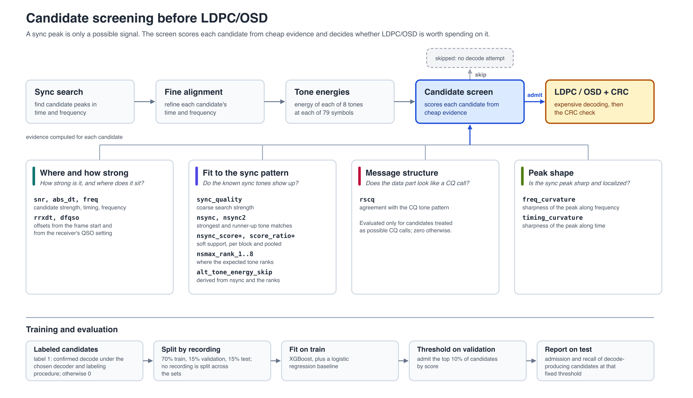

# ft8-ml

Training and evaluation code for machine-learned components of FT8
decoding.

- [`candidate-screening/`](candidate-screening/): gradient-boosted trees
  that rank synchronization candidates before LDPC decoding.

See [FEATURES.md](candidate-screening/FEATURES.md) for what each column
measures.

Datasets, trained models, and decoder integration are not included.

## License

Licensed under either of

- Apache License, Version 2.0 ([LICENSE-APACHE](LICENSE-APACHE))
- MIT license ([LICENSE-MIT](LICENSE-MIT))

at your option.
