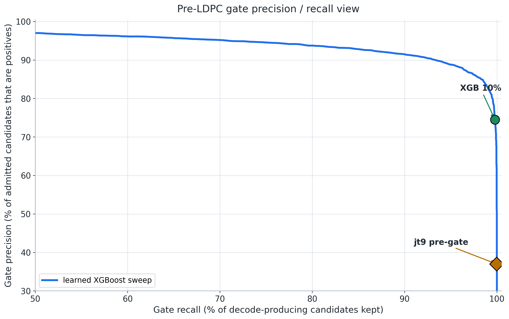

# Screening FT8 candidates with boosted trees

A binary classifier can rank FT8 synchronization candidates before an
expensive LDPC/OSD decoding attempt. This example trains XGBoost and a logistic
regression baseline on precomputed tabular features. It splits recordings into
training, validation, and test groups to keep candidates from the same recording
in the same split.

## Input

Provide a CSV with one row per candidate:

- `group_id`: recording identifier, shared by all candidates from that recording.
- `label`: `1` if the candidate produced a confirmed decode under the chosen
  decoder and labeling procedure, or `0` otherwise.
- Numeric feature columns, such as signal-to-noise estimate, timing and
  frequency offsets, or sync-quality measurements. An empty field represents a
  missing value.

The label describes the outcome under a particular decoder and labeling
procedure. It does not necessarily say whether a physical signal was present.
Feature extraction and labeling are supplied by the user. The training data and
historical model are not included.

The historical experiment used signal estimates (`snr`, `abs_dt`, `freq`),
sync counts and quality (`nsync`, `nsync2`, `sync_quality`), aggregate and
per-block sync scores and ratios (`nsync_score`, `nsync_score_a` through
`nsync_score_c`, `nsync_score_wild`, `score_ratio`, and `score_ratio_a`
through `score_ratio_c`), and a CQ-shape score (`rscq`). Other inputs included
relative timing and frequency (`rrxdt`, `dfqso`), timing and frequency
curvature, the eight expected-tone rank counts (`nsmax_rank_1` through
`nsmax_rank_8`), and an alternative-tone indicator (`alt_tone_energy_skip`).
These columns are measurements supplied to the classifier; selecting matching
names alone does not ensure that independently produced values have the same
definitions or units.

## Train

Install the dependencies in `requirements.txt` in a Python environment, then
specify the input and feature columns:

```sh
python train.py candidates.csv --features snr abs_dt freq sync_quality
```

The script prints ROC AUC and average precision for each group split. XGBoost
uses its native missing-value handling; logistic regression fills missing
values using training-set medians and standardizes the features. Both models
are fitted only on the training split. For each model, it also selects a
threshold at the 10% admission point on validation data and reports admission
and positive recall at that fixed threshold on test data. Tied scores may
increase validation admission above 10%.

## Historical result



The figure shows a historical offline, single-pass evaluation on 382 held-out
recordings. At 10% candidate admission, the XGBoost ranking retained about 99.8%
of the labeled decode-producing candidates present in that evaluated candidate
set. This is candidate-level recall, not overall decoder recall. The plotted
jt9-style point is a comparison with a separately evaluated baseline.

The curve is a retrospective ranking sweep on the held-out set, rather than a
prospective evaluation of a threshold selected in advance. A point in a ranked
sweep may not be achievable by a single score threshold when scores tie. The
figure does not measure end-to-end CPU or wall-clock savings.
