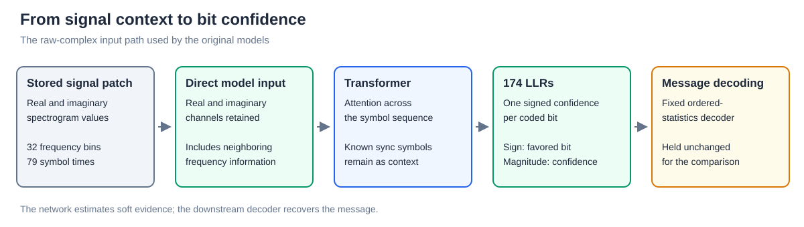
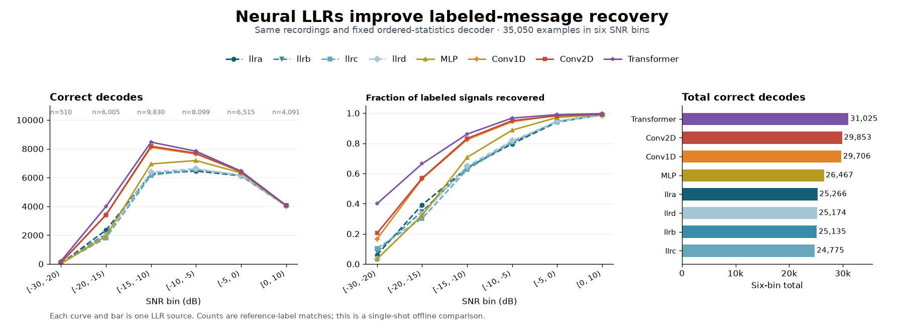

# Neural LLR Estimation for FT8 Soft Demodulation

Presented at [PAARA, May 2026](https://www.youtube.com/watch?v=sWgwwGcMSsk).
See [USAGE.md](USAGE.md) for dataset schema, training, evaluation, and ONNX
export.

An FT8 transmission encodes a 77-bit payload and 14-bit CRC with a `(174, 91)`
LDPC code and maps the 174 coded bits onto 58 Gray-coded 8-FSK data symbols,
interleaved with three 7-symbol Costas synchronization arrays to form a
79-symbol frame (12.64 s at 6.25 Bd). Before error correction, the demodulator
maps the received time-frequency grid to 174 log-likelihood ratios (LLRs), one
signed log-odds estimate per coded bit.

Fixing the candidate time-frequency coordinates and a downstream
ordered-statistics decoder (OSD) while varying only the 174 input LLRs isolates
the soft-demodulation stage from synchronization and multipass subtraction.
Across 35,050 labeled off-air signal examples spanning `[-30, 10)` dB SNR, a
159k-parameter Transformer operating on a 32-bin complex symbol spectrogram
recovered **31,025** messages, compared with **25,266** for the strongest
overall analytical baseline (+22.8%). In `[-30, -20)` dB it recovered 204 of
510 examples, against 53 for the best baseline in that bin.

## Motivation

Under stationary AWGN, single-symbol noncoherent tone-energy detection treats
each symbol's phase as independent, and short multi-symbol block combining
trades frequency-offset tolerance for small integration gains. Live
HF passbands violate those assumptions regularly: selective and time-varying
fading modulate amplitude and phase across the 12.64 s frame, overlapping
transmissions corrupt subsets of tones and symbols, impulsive noise distorts
isolated symbol intervals, and candidate synchronization leaves residual time
and frequency offsets.

Downstream soft decoders depend on relative LLR magnitudes across the frame as
well as hard-decision bit signs. Belief propagation converts input LLRs into
check-to-variable messages whose saturation depends on LLR scale, and OSD sorts
the 174 bit positions by `|LLR|` to select 91 linearly independent columns as
its most-reliable basis (MRB). Overconfident bit estimates on an
interference-hit or faded symbol place errors inside the MRB, where low-order
test-error search cannot flip them within a practical search budget.

Training a network against ground-truth codeword bits with binary cross-entropy
(`BCEWithLogitsLoss`) penalizes miscalibrated log-odds directly. Including
off-tone frequency bins and the full 79-symbol sequence (with the 21 known
Costas pilot symbols intact) gives the estimator information about local
interference, noise floor, channel envelope, and residual alignment when
assigning bit reliability.

## Input Representation and Architectures

Each input example (`spectrogram32`) has shape `(2, 32, 79)` and is extracted
at a reference signal coordinate from an unsubtracted HF recording. The 79
columns correspond to the FT8 symbol intervals (Costas blocks at `0–6`,
`36–42`, and `72–78`; data symbols at `7–35` and `43–71`), and the 32 rows
cover the 8 nominal FSK tone bins plus surrounding off-tone bins. In the
experiments reported here, the models consumed the stored real and imaginary
FFT channels directly (`raw-complex` in `train.py`; a phase-invariant
`magnitude-phase` option was added later).

All four architectures in [`models.py`](models.py) apply a shared
`Linear(..., 3)` readout at the 58 data-symbol positions to produce 174 bit
logits:

| Model | Parameters | Receptive field and structure |
| --- | ---: | --- |
| `MLP` | 8,515 | Shared `64 -> 64 -> 64 -> 3` GELU network applied independently to each data symbol; uses the 32-bin local spectrum with no temporal context. |
| `Conv1D` | 115,139 | Four 1D convolutional layers (`kernel_size=7`, 64 channels) across all 79 symbols, treating the `2 × 32` complex bins as input channels (25-symbol receptive field). |
| `Conv2D` | 66,083 | Four 2D convolutional layers (`3 × 7` frequency-by-time kernels, 32 channels) followed by adaptive average pooling over frequency. |
| `Transformer` | 159,363 | Linear projection to `d_model=64`, learned 79-step positional embeddings, and three pre-norm encoder layers (`nhead=4`, `dim_feedforward=256`) with full-frame self-attention. |

Four analytical baselines (`llra`, `llrb`, `llrc`, `llrd`) represent
conventional 1-, 2-, and 3-symbol block estimators (`llra`–`llrc`), with `llrd`
applying positive magnitude normalization to `llra` (preserving hard-decision
signs while compressing LLR scale and re-weighting symbols of different
amplitude).

## Held-Out Evaluation on Off-Air Recordings

Recordings were grouped by `YYMMDD` date prefix so examples from the same
operating session and propagation conditions never straddled splits. Date group
`241123` was held out for testing, with earlier date groups divided between
training and validation.

The `241123` test split contains **35,060** labeled signal examples across
**1,808** WAV files. Ten examples outside `[-30, 10)` dB SNR were recovered by
all eight sources; the remaining **35,050** examples fall into six left-closed,
right-open SNR bins (dB). Each row below feeds its 174 LLRs into the same
fixed OSD configuration in a single attempt per example and counts CRC-valid
decodes matching the reference message:

| LLR source | Bit acc | BCE | [-30, -20) | [-20, -15) | [-15, -10) | [-10, -5) | [-5, 0) | [0, 10) | Six-bin total |
| --- | ---: | ---: | ---: | ---: | ---: | ---: | ---: | ---: | ---: |
| *Examples in bin* | — | — | *510* | *6,005* | *9,830* | *8,099* | *6,515* | *4,091* | *35,050* |
| `llra` | 0.8978 | 0.8142 | 31 | 2,353 | 6,256 | 6,452 | 6,127 | 4,047 | 25,266 |
| `llrb` | 0.8949 | 0.8240 | 42 | 2,096 | 6,260 | 6,533 | 6,158 | 4,046 | 25,135 |
| `llrc` | 0.8902 | 0.8580 | 53 | 1,810 | 6,150 | 6,546 | 6,169 | 4,047 | 24,775 |
| `llrd` | 0.8978 | 0.4563 | 17 | 1,975 | 6,383 | 6,619 | 6,147 | 4,033 | 25,174 |
| `MLP` | 0.9104 | 0.2145 | 17 | 1,934 | 6,949 | 7,185 | 6,329 | 4,053 | 26,467 |
| `Conv1D` | 0.9289 | 0.1544 | 85 | 3,392 | 8,104 | 7,638 | 6,423 | 4,064 | 29,706 |
| `Conv2D` | 0.9306 | 0.1537 | 104 | 3,415 | 8,179 | 7,695 | 6,402 | 4,058 | 29,853 |
| `Transformer` | **0.9380** | **0.1360** | **204** | **3,991** | **8,465** | **7,834** | **6,452** | **4,079** | **31,025** |

*Bit accuracy (`sign(LLR)` agreement with the ground-truth codeword) and
per-bit BCE are evaluated over all 35,060 test examples. BCE is sensitive to
overall LLR scale, which accounts for the large difference between unnormalized
`llra`–`llrc` and normalized `llrd`.*

Above `-5` dB, all estimators approach saturation. Below `-15` dB, no single
analytical baseline dominates: 3-symbol integration (`llrc`) edges out `llra`
in `[-30, -20)` dB (53 vs. 31) but loses ground in `[-20, -15)` dB (1,810 vs.
2,353), consistent with phase drift and non-stationary interference penalizing
longer integration windows. Operating on a single data symbol's 32-bin
spectrum at a time, `MLP` beats every analytical baseline in `[-15, -5)` dB
(6,949 vs. 6,383 and 7,185 vs. 6,619 against `llrd`), but trails `llra`,
`llrb`, and `llrd` in `[-20, -15)` dB and ties `llrd` at 17 decodes in
`[-30, -20)` dB.

Adding temporal context produces the main weak-signal jump: `Conv1D` adds
3,239 decodes over `MLP`, mostly below `-10` dB. `Transformer` adds another
1,172 decodes over `Conv2D` and 1,319 over `Conv1D`, leading every bin and
reaching 40.0% recovery (`204 / 510`) in `[-30, -20)` dB and 66.5%
(`3,991 / 6,005`) in `[-20, -15)` dB.

## Receptive Field and CPU Latency

The gap between `Conv1D` and `Transformer` does not by itself prove that global
Costas-to-data attention is required: the two models differ in per-symbol
capacity and normalization as well as receptive field (25 symbols vs. 79
symbols). Separating medium-range channel tracking from full-frame pilot
conditioning requires controlled ablations such as windowed self-attention
(`±w` symbols) or dilated 1D convolutions.

CPU latency further constrains which architectures are practical inside a
15-second FT8 cycle. In model-only ONNX Runtime benchmarks on macOS CPU
(`batch_size = 50`, excluding FFT extraction and LDPC/OSD decoding), mean
inference time per candidate was:

| Model | Parameters | ONNX CPU latency (`batch = 50`) |
| --- | ---: | ---: |
| `MLP` | 8,515 | ~15 µs / candidate |
| `Conv1D` | 115,139 | ~44 µs / candidate |
| `Transformer` | 159,363 | ~159 µs / candidate |
| `Conv2D` | 66,083 | ~751 µs / candidate |

Parameter count is a poor guide to CPU cost here: 2D convolutions over a
`32 × 79` grid make `Conv2D` nearly 5× slower than `Transformer` and 17×
slower than `Conv1D` for only 147 additional decodes over `Conv1D`. At ~159 µs
per candidate, evaluating a few hundred synchronized candidates takes well
under 100 ms on CPU without a GPU, while `Conv1D` provides a 3.6× faster
operating point where compute is tighter.

## Scope and Limitations

- **Single-shot demodulation vs. multipass subtraction.** Operational FT8
  receivers run multiple passes with successive interference cancellation (SIC)
  and try several LLR and *a priori* configurations per candidate. Here every
  evaluated LLR source, analytical and neural, gets one fixed-OSD attempt at a
  reference coordinate on unsubtracted audio, whereas the reference labels come
  from multipass decodes that subtract strong signals between passes. Signals
  decoded during labeling only after subtracting a stronger neighbor are
  therefore tested here with that interferer still present. Single-pass
  decoding through interference likely accounts for part of the neural gain
  over `llra`–`llrd`, though the table does not separate interference-masked
  signals from isolated weak signals. In a full receiver, subtraction would
  expose some of those signals to the analytical baselines as well, while
  stronger first-pass recovery could improve subtraction for later passes. Net
  end-to-end gain requires closed-loop multipass evaluation.
- **Reference alignment vs. live sync error.** Evaluating all eight LLR sources
  at reference `(freq, dt)` coordinates isolates soft demodulation from
  candidate search. Open-passband false-alarm rates on noise-only sync
  candidates are therefore not measured here, and reference coordinates from
  confirmed decodes may be slightly better aligned than pre-decode fine-sync
  estimates near threshold. Training and testing under small time and frequency
  perturbations is a natural next check.
- **Bootstrapped reference labels.** Off-air recordings have no independent
  transmitter log; the test set consists of multipass `jt9` reference decodes
  rather than every physical transmission present on the air.

## Repository Contents

This directory contains a standalone PyTorch workflow ([`USAGE.md`](USAGE.md)):

- [`models.py`](models.py): `PerSymbolMLP`, `Conv1DNet`, `Conv2DNet`, and
  `SymbolTransformer`.
- [`data.py`](data.py): Lance dataset loader, `raw-complex` and
  `magnitude-phase` feature preparation, and date-grouped split isolation.
- [`train.py`](train.py), [`evaluate.py`](evaluate.py),
  [`metrics.py`](metrics.py): `BCEWithLogitsLoss` training and held-out bit
  accuracy / BCE evaluation by SNR bin.
- [`export_onnx.py`](export_onnx.py): fixed-batch ONNX export and ONNX Runtime
  numerical verification.
